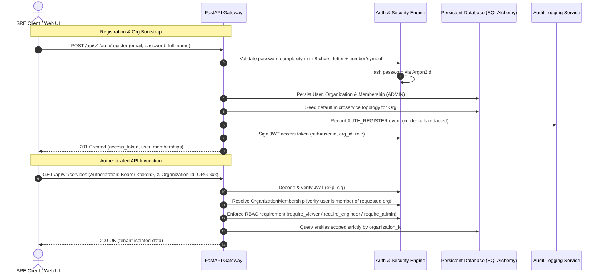
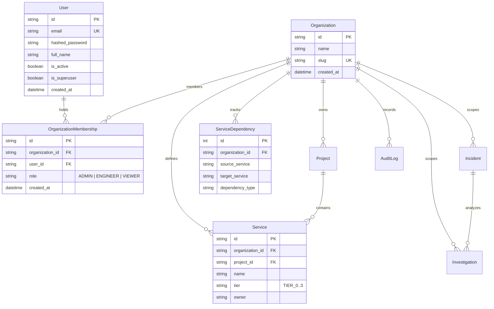

# RecallOps-AI — Authentication, RBAC & Multi-Tenant Architecture

## 1. Executive Summary

RecallOps-AI implements an enterprise-grade, multi-tenant security architecture designed for mission-critical SRE operations. It incorporates:
- **Argon2id Password Hashing**: State-of-the-art memory-hard hashing resistant to GPU/ASIC cracking.
- **Stateless JWT Authentication**: PyJWT signed HS256 access tokens with configurable expiration and claims.
- **Hierarchical Role-Based Access Control (RBAC)**: Declarative FastAPI route dependencies enforcing `Admin`, `Engineer`, and `Viewer` capabilities.
- **Strict Multi-Tenant Isolation**: Tenant scoping across organizations, projects, services, incidents, AI investigations, and service topologies.
- **Persistent Service Topology Graph**: Database-backed service and dependency persistence replacing ephemeral RAM caches with BFS blast-radius analysis and DFS cycle detection across application restarts.
- **Security Audit Logging**: Comprehensive, sanitized audit trail capturing administrative and operational events without leaking credentials or tokens.

---

## 2. Authentication Architecture



### 2.1 Password Security (Argon2id)
Passwords are never stored in plaintext. They are hashed using **Argon2id** (`argon2-cffi`), the winner of the Password Hashing Competition (PHC):
- Memory-hard parameters prevent brute-force attacks via FPGA or GPU clusters.
- Configurable minimum password length (default: 8 characters) with enforced character complexity (at least one letter, at least one number or special symbol).

### 2.2 JWT Token Claims & Verification
Access tokens are signed using HMAC-SHA256 (`HS256`) with a cryptographically secure secret (`JWT_SECRET_KEY`):
- `sub`: Unique user ID (`USR-xxxx`).
- `email`: User email address.
- `org_id`: Active default organization ID.
- `role`: Membership role within the default organization.
- `iat`: Epoch timestamp when token was issued.
- `exp`: Epoch expiration timestamp (default: 60 minutes).

Tokens are decoded and validated by `backend/app/auth/jwt.py:decode_access_token`. Expired tokens yield HTTP 401 Unauthorized with descriptive challenge headers (`WWW-Authenticate: Bearer`).

---

## 3. Multi-Tenancy & Data Model

RecallOps-AI separates customer data through strict database tenancy keys on all core entities:



### 3.1 Tenant Context Resolution
The active organization context is determined per request via FastAPI dependencies:
1. **Header-Based Selection (`X-Organization-Id`)**: Allows multi-org users to specify the organization context explicitly.
2. **Default Fallback**: If `X-Organization-Id` is omitted, the dependency selects the user's primary/first organization membership.
3. **Cross-Tenant Prevention**: If a user attempts to specify an `X-Organization-Id` where they hold no membership, the request is immediately rejected with `403 Forbidden`.
4. **Data Isolation**: All queries against `incidents`, `investigations`, `services`, `projects`, `service_dependencies`, and `audit_logs` enforce `WHERE organization_id = :current_org_id`. Cross-tenant record lookups return `404 Not Found` to prevent tenancy enumeration.

---

## 4. Role-Based Access Control (RBAC)

### 4.1 Role Hierarchy

| Role | Hierarchy Level | Capabilities |
| :--- | :---: | :--- |
| **Admin** | Level 3 | Full administrative power: create organizations, invite/remove members, modify member roles, manage all projects, services, dependencies, and view audit logs. |
| **Engineer** | Level 2 | Operational read-write power: create projects, register services, declare microservice dependencies, create/triage/resolve incidents, execute AI investigations, and approve/reject AI resolutions. |
| **Viewer** | Level 1 | Read-only power: view projects, services, dependencies, inspect blast-radius estimates, read incidents, inspect AI investigation reports, and browse audit logs. **Cannot mutate state or resolve incidents.** |

### 4.2 Declarative Endpoint Enforcement
Rather than ad-hoc role checks scattered in endpoint handlers, RBAC is enforced declaratively at the routing boundary:

```python
from backend.app.auth.permissions import require_admin, require_engineer, require_viewer

@router.post("/services", response_model=ServiceResponse)
def create_service(
    payload: ServiceCreate,
    membership: OrganizationMembership = Depends(require_engineer),
    db: Session = Depends(get_db)
):
    ...
```

If a user with `VIEWER` role calls an endpoint requiring `require_engineer`, FastAPI immediately returns:
```json
{
  "detail": "Operation requires 'ENGINEER' role or higher. Your role: 'VIEWER'."
}
```
with status code `403 Forbidden`.

---

## 5. Persistent Service Topology Engine

In previous iterations, the microservice dependency DAG resided strictly in ephemeral RAM. Phase 4 introduces database-backed persistence:

### 5.1 Tables
- `services`: Stores microservice definitions with operational tier (`TIER_0`, `TIER_1`, `TIER_2`, `TIER_3`), service owner, and project assignment.
- `service_dependencies`: Stores directional dependency edges (`source_service` -> `target_service`) representing that `source_service` relies upon `target_service`.

### 5.2 Dynamic In-Memory Cache Rehydration
`TopologyService` maintains an in-memory graph cache per organization. On application startup or when an organization is accessed:
1. `TopologyService.rehydrate_from_db(db, organization_id)` queries the persistent database.
2. The `ServiceTopologyGraph` is rebuilt in memory.
3. When mutations occur (`POST /api/v1/topology/dependencies` or `DELETE /api/v1/topology/dependencies/{id}`), both the persistent database table and the in-memory graph are updated synchronously.

### 5.3 Graph Algorithms
- **Blast Radius Calculation (BFS)**: Computes downstream impact when a service fails. Traverse downstream dependents with distance penalty weights ($W = \frac{1}{\text{depth} + 1}$).
- **Cycle Detection (DFS)**: 3-color cycle detection (White/Grey/Black) detects cyclic architecture loops and returns full cycle paths via `GET /api/v1/topology/cycles`.

---

## 6. Security Audit Logging

All administrative, authorization, and incident state changes are recorded in the `audit_logs` table:

### 6.1 Logged Actions
- `AUTH_REGISTER`: New user registration and organization creation.
- `AUTH_LOGIN`: Successful user authentication.
- `AUTH_LOGIN_FAILED`: Failed login attempts (invalid password or unknown email).
- `ORGANIZATION_CREATE`: Organization creation.
- `MEMBER_ADD`: New team member added to organization.
- `MEMBER_ROLE_UPDATE`: Role change (e.g. VIEWER -> ENGINEER).
- `PROJECT_CREATE`: New project created.
- `SERVICE_CREATE`: New service registered.
- `DEPENDENCY_ADD`: Service dependency edge established.
- `DEPENDENCY_DELETE`: Service dependency edge removed.
- `INCIDENT_CREATE`: Incident ingested or manually created.
- `INCIDENT_RESOLVE`: Incident resolved by an engineer.
- `INVESTIGATION_RUN`: AI investigation triggered.
- `INVESTIGATION_FEEDBACK`: Human engineer approval/rejection of AI recommendations.

### 6.2 Automatic Credential & Secret Redaction
The audit logging engine inspects all metadata payloads recursively and scrubs sensitive keys:
- Keys containing `password`, `token`, `secret`, `api_key`, `authorization`, `cookie` are automatically replaced with `[REDACTED]`.
- Raw authorization tokens and client credentials are never written to disk or the database.

---

## 7. Webhook & Episodic Memory Compatibility

Phase 4 maintains 100% backward compatibility with prior capabilities:
- **Webhook Ingestion**: PagerDuty (v2/v3 HMAC), Datadog, and Prometheus Alertmanager endpoints do **not** require human JWT authentication. They authenticate via provider signatures and shared bearer secrets as verified in Phase 2.
- **Episodic Memory**: Incidents resolved by verified engineers continue to enter persistent vector episodic memory (`IncidentResolution`). Viewers are strictly barred from resolving incidents or adding untrusted entries to episodic memory.
- **AI Investigation Engine**: All multi-modal evidence collection, prompt injection mitigation, and grounding citation validation from Phase 3 operate seamlessly within tenant boundaries.
