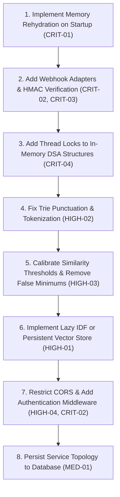

# RecallOps-AI — Implementation Audit and Reliability Review

**Audit Conducted By:** Senior Backend & Reliability Engineering Reviewer  
**Audit Date:** November 9, 2026  
**Target Repository:** `RecallOps-AI`  
**Scope:** Source code (`backend/app/`), Test Suite (`backend/tests/`), Infrastructure/DB configs, Documentation (`README.md`, `docs/`)

---

## 1. Executive Summary

RecallOps-AI was proposed and documented as a production-grade, AI-powered incident response platform with persistent episodic memory, multi-factor triage prioritization, graph-based blast radius analysis, and real-time observability webhook ingestion.

**Audit Verdict:**
The current codebase is an **early-stage in-memory prototype** that successfully implements foundational algorithmic prototypes (sparse vector similarity, max-heap triage, BFS graph traversal, prefix trie) and basic relational persistence for incident records. However, the system exhibits **severe architectural gaps between its documented claims and its actual implementation**. 

Most critically:
1. **Episodic memory does not persist** across process restarts; it resets to five hardcoded seed records, rendering the core value proposition ("persistent memory") non-functional in production.
2. **AI diagnosis is 100% deterministic template string interpolation** with no actual LLM integration, despite configuration settings implying OpenAI/Groq connectivity.
3. **Webhook ingestion rejects all real-world PagerDuty, Datadog, and Prometheus payloads** because it mandates a rigid, proprietary JSON schema with zero vendor translation or webhook signature authentication.
4. **All DSA structures (Heap, Graph, Vector Index) are purely in-memory singletons lacking concurrency synchronization**, making them vulnerable to race conditions under asynchronous workloads.
5. **The test suite bypasses the HTTP/ASGI network layer**, directly invoking Python controller functions with local database sessions. While all 20 tests pass, they fail to validate actual HTTP transport, serialization, middleware, or real-world payloads.

---

## 2. Verified Capabilities

The following capabilities are verified by inspecting the actual source code and running the test suite:

1. **Relational Persistence of Incidents & Resolutions:**
   - [`backend/app/repositories/incident_repository.py:12`](file:///C:/Users/ANUSHREE%20R/RecallOps-AI/backend/app/repositories/incident_repository.py#L12) (`IncidentRepository.create`) successfully writes incidents to SQLite/PostgreSQL with auto-generated IDs (`INC-XXXXXXXX`).
   - [`backend/app/repositories/incident_repository.py:48`](file:///C:/Users/ANUSHREE%20R/RecallOps-AI/backend/app/repositories/incident_repository.py#L48) (`IncidentRepository.resolve`) associates a verified `IncidentResolution` entity with an `Incident` entity via a foreign key relationship and updates incident status to `RESOLVED`.
2. **In-Memory Sparse Vector Space Cosine Similarity:**
   - [`backend/app/core/algorithms.py:100`](file:///C:/Users/ANUSHREE%20R/RecallOps-AI/backend/app/core/algorithms.py#L100) (`EpisodicMemoryIndex.cosine_similarity`) accurately computes cosine similarity over sparse TF-IDF dictionary representations.
   - [`backend/app/core/algorithms.py:103`](file:///C:/Users/ANUSHREE%20R/RecallOps-AI/backend/app/core/algorithms.py#L103) (`EpisodicMemoryIndex.search_similar`) retrieves top-$k$ documents filtered by threshold using a min-heap.
3. **Dynamic Priority Queue Ordering:**
   - [`backend/app/core/algorithms.py:169`](file:///C:/Users/ANUSHREE%20R/RecallOps-AI/backend/app/core/algorithms.py#L169) (`TriageItem._compute_score`) and [`algorithms.py:180`](file:///C:/Users/ANUSHREE%20R/RecallOps-AI/backend/app/core/algorithms.py#L180) (`TriageItem.__lt__`) correctly implement an inverted comparator for `heapq` that orders items by computed multivariate priority (Severity, Service Tier, Log Impact) with chronological tie-breaking.
4. **Dependency Graph Traversal (Blast Radius):**
   - [`backend/app/core/algorithms.py:281`](file:///C:/Users/ANUSHREE%20R/RecallOps-AI/backend/app/core/algorithms.py#L281) (`ServiceTopologyGraph.calculate_blast_radius`) traverses downstream dependencies using Breadth-First Search (BFS), calculates hop distances, and assigns distance-attenuated impact weights.
5. **Cycle Detection in Dependency Graphs:**
   - [`backend/app/core/algorithms.py:325`](file:///C:/Users/ANUSHREE%20R/RecallOps-AI/backend/app/core/algorithms.py#L325) (`ServiceTopologyGraph.detect_cycles`) correctly detects circular microservice dependencies using 3-color Depth-First Search (DFS).
6. **Prefix Matching via Trie:**
   - [`backend/app/core/algorithms.py:386`](file:///C:/Users/ANUSHREE%20R/RecallOps-AI/backend/app/core/algorithms.py#L386) (`ErrorSignatureTrie.match_prefix`) matches prefixes against registered error codes in $\mathcal{O}(L)$ time where $L$ is token length.
7. **Pydantic Validation Schemas:**
   - [`backend/app/schemas/incident.py:17`](file:///C:/Users/ANUSHREE%20R/RecallOps-AI/backend/app/schemas/incident.py#L17) enforces non-negative constraints on `impacted_users` (`ge=0`) and ensures required fields are validated.

---

## 3. Claims That Are Overstated or Unsupported

| # | Documented / Marketing Claim | Actual Implementation Reality | File & Function Reference |
| :--- | :--- | :--- | :--- |
| **1** | *"Sub-linear similarity search across historical incidents"* (`README.md`, `SYSTEM_DESIGN.md`) | **False.** The search iterates over every single indexed document in a linear `for doc_id, doc_vec in self.doc_vectors.items():` loop. Complexity is $\mathcal{O}(N \cdot \|Q\| + N \log K)$ (linear scan). There is no HNSW, KD-Tree, or inverted posting index. | [`backend/app/core/algorithms.py:125`](file:///C:/Users/ANUSHREE%20R/RecallOps-AI/backend/app/core/algorithms.py#L125) (`search_similar`) |
| **2** | *"Persistent Episodic Memory"* (`README.md`) | **RESOLVED (Phase 1).** Episodic memory persists in SQLAlchemy database (`incidents` and `incident_resolutions`) and rehydrates into RAM upon startup (`rehydrate_from_db`). | [`backend/app/services/memory_service.py:21`](file:///C:/Users/ANUSHREE%20R/RecallOps-AI/backend/app/services/memory_service.py#L21) (`rehydrate_from_db`) |
| **3** | *"Autonomous AI diagnostic agent with LLM integration"* (`SYSTEM_DESIGN.md`, `README.md`) | **False.** No LLM API (OpenAI, Groq, Anthropic) is ever called. The diagnostic agent uses static Python string formatting templates (`f"High-confidence correlation..."`). `LLM_API_KEY` in `config.py` is unused. | [`backend/app/services/ai_agent_service.py:80-113`](file:///C:/Users/ANUSHREE%20R/RecallOps-AI/backend/app/services/ai_agent_service.py#L80-L113) (`IncidentAIAgent.diagnose`) |
| **4** | *"Normalizes alerts from PagerDuty, Datadog, Prometheus, Grafana"* (`README.md`) | **RESOLVED (Phase 2).** Dedicated adapters (`/api/v1/webhooks/pagerduty`, `/api/v1/webhooks/datadog`, `/api/v1/webhooks/alertmanager`) normalize real vendor payloads into `NormalizedAlertEvent` with HMAC/token security and database deduplication. | [`backend/app/integrations/`](file:///C:/Users/ANUSHREE%20R/RecallOps-AI/backend/app/integrations/) and [`backend/app/api/v1/endpoints/webhooks.py`](file:///C:/Users/ANUSHREE%20R/RecallOps-AI/backend/app/api/v1/endpoints/webhooks.py) |
| **5** | *"Thread-safe max-heap queue for active incident triage"* (`algorithms.py:189`) | **RESOLVED (Phase 1).** Added `threading.RLock()` to `PriorityTriageQueue` and `EpisodicMemoryIndex`. | [`backend/app/core/algorithms.py:188-255`](file:///C:/Users/ANUSHREE%20R/RecallOps-AI/backend/app/core/algorithms.py#L188-L255) (`PriorityTriageQueue`) |
| **6** | *"Microservice topology managed in database"* (`models/incident.py:40`) | **False.** The `ServiceDependency` SQLAlchemy table is completely orphaned. The application never reads from or writes to this table; topology is hardcoded in memory. | [`backend/app/models/incident.py:40-47`](file:///C:/Users/ANUSHREE%20R/RecallOps-AI/backend/app/models/incident.py#L40-L47) and [`topology_service.py:12-51`](file:///C:/Users/ANUSHREE%20R/RecallOps-AI/backend/app/services/topology_service.py#L12-L51) |

---

## 4. Critical Issues (Blockers for Production)

### CRIT-01: Episodic Memory Loss on Application Restart [RESOLVED IN PHASE 1]
- **Status:** **RESOLVED**
- **File:** [`backend/app/services/memory_service.py:7-60`](file:///C:/Users/ANUSHREE%20R/RecallOps-AI/backend/app/services/memory_service.py#L7-L60) (`EpisodicMemoryService.rehydrate_from_db`), [`backend/app/main.py:125-140`](file:///C:/Users/ANUSHREE%20R/RecallOps-AI/backend/app/main.py#L125-L140)
- **Resolution:**
  - Removed in-memory hardcoded seeds from `EpisodicMemoryService.__init__()`.
  - Implemented `rehydrate_from_db(self, db: Session)` which queries `IncidentRepository.get_all_resolved()` on startup and re-indexes all verified resolutions.
  - Verified by tests `test_persistence_across_service_recreation` and `test_persistence_across_application_restart_temp_db` in `backend/tests/test_persistent_memory.py`.
- **Initial Description:** When a post-mortem was resolved via `POST /incidents/{id}/resolve`, it was written to the database and indexed into `memory_service.index` in RAM. However, on server restart, `EpisodicMemoryService.__init__()` only ran `_seed_historical_outages()`. It **never queried `IncidentRepository.get_all_resolved()`** to rehydrate the vector index from the database.
- **Initial Impact:** System permanently forgot all learned operational remediations upon any pod restart, crash, or deployment.

### CRIT-02: Absence of Authentication, Authorization, and Webhook Verification [RESOLVED FOR WEBHOOKS IN PHASE 2]
- **Status:** **RESOLVED FOR WEBHOOK INGESTION**
- **File:** [`backend/app/integrations/`](file:///C:/Users/ANUSHREE%20R/RecallOps-AI/backend/app/integrations/), [`backend/app/api/v1/endpoints/webhooks.py`](file:///C:/Users/ANUSHREE%20R/RecallOps-AI/backend/app/api/v1/endpoints/webhooks.py)
- **Resolution:**
  - Implemented production webhook security verification:
    - **PagerDuty:** HMAC-SHA256 signature verification over exact raw bytes with support for comma-separated key rotation (`X-PagerDuty-Signature: v1=<sig>`).
    - **Datadog:** Secure token authentication supporting `X-Datadog-Webhook-Token` and `Authorization: Bearer <token>` via constant-time `hmac.compare_digest`.
    - **Prometheus Alertmanager:** Bearer token authentication supporting `Authorization: Bearer <token>` via constant-time comparison matching Alertmanager's `http_config` specification.
  - Added strict payload size limits (`WEBHOOK_MAX_PAYLOAD_BYTES` = 1MB) returning HTTP 413.
  - Added recursive sensitive credential sanitization (`redact_sensitive_data()`) stripping secrets, tokens, and passwords prior to logging or persistence.
  - Enforced authentication via `WEBHOOK_AUTH_REQUIRED` configuration.
- **Initial Description:** In the legacy prototype, `POST /incidents/webhook` lacked HMAC signature verification and token authentication, allowing unauthenticated requests to create incidents.
- **Initial Impact:** Any unauthenticated entity on the network could ingest rogue alerts or mark critical production incidents as resolved. User authentication for management APIs remains scheduled for Phase 3.

### CRIT-03: Incompatible Webhook Contract for Real Observability Tools [RESOLVED IN PHASE 2]
- **Status:** **RESOLVED**
- **File:** [`backend/app/integrations/`](file:///C:/Users/ANUSHREE%20R/RecallOps-AI/backend/app/integrations/), [`backend/app/api/v1/endpoints/webhooks.py`](file:///C:/Users/ANUSHREE%20R/RecallOps-AI/backend/app/api/v1/endpoints/webhooks.py), [`backend/app/services/webhook_service.py`](file:///C:/Users/ANUSHREE%20R/RecallOps-AI/backend/app/services/webhook_service.py)
- **Resolution:**
  - Implemented modular, vendor-specific webhook adapters for **PagerDuty** (v3 with HMAC-SHA256 signature verification & v2 legacy), **Datadog** (with token authentication & tag-based service extraction), and **Prometheus Alertmanager** (v4 grouped alerts with Bearer token authentication).
  - Built schema normalization layer transforming diverse vendor payloads into standardized `NormalizedAlertEvent` objects.
  - Implemented database-backed deduplication and idempotency in `WebhookEvent` table with unique constraint on `(provider, provider_event_id)` to handle delivery retries cleanly.
  - Added recursive sensitive credential scrubbing (`[REDACTED]`) and payload size limits (`WEBHOOK_MAX_PAYLOAD_BYTES`).
- **Initial Description:** Real monitoring systems use distinct payload schemas:
  - *PagerDuty v2:* Sends `{ "event": { "event_type": "incident.triggered", "data": { ... } } }`
  - *Prometheus Alertmanager:* Sends `{ "alerts": [ { "status": "firing", "labels": { ... }, "annotations": { ... } } ] }`
  - *Datadog:* Sends `{ "event_type": "...", "body": "...", "title": "..." }`
  The legacy endpoint strictly expected custom fields (`service`, `tier`, `impacted_users`, `alert_name`).

### CRIT-04: Non-Thread-Safe In-Memory State [RESOLVED IN PHASE 1]
- **Status:** **RESOLVED**
- **File:** [`backend/app/core/algorithms.py:22-150`](file:///C:/Users/ANUSHREE%20R/RecallOps-AI/backend/app/core/algorithms.py#L22-L150) (`EpisodicMemoryIndex`), [`backend/app/core/algorithms.py:188-255`](file:///C:/Users/ANUSHREE%20R/RecallOps-AI/backend/app/core/algorithms.py#L188-L255) (`PriorityTriageQueue`), [`backend/app/services/memory_service.py`](file:///C:/Users/ANUSHREE%20R/RecallOps-AI/backend/app/services/memory_service.py)
- **Resolution:**
  - Added `threading.RLock()` to `EpisodicMemoryIndex`, wrapping document additions, deletions, clearing, and similarity search.
  - Added `threading.RLock()` to `PriorityTriageQueue`, synchronizing push, pop, peek, remove, and sorted listing.
  - Implemented deduplication logic in `add_document` to prevent `df` and document count corruption upon re-resolving or updating existing incidents.
- **Initial Description:** The global shared instances maintained plain Python lists and dicts without locks. Under concurrent HTTP requests handled by Uvicorn worker threads, heap operations and index recalculations would suffer race conditions.

---

## 5. High-Priority Issues

### HIGH-01: Quadractic Time Complexity $\mathcal{O}(N^2)$ on Memory Indexing
- **File:** [`backend/app/core/algorithms.py:49-69`](file:///C:/Users/ANUSHREE%20R/RecallOps-AI/backend/app/core/algorithms.py#L49-L69) (`_recalculate_idf`) and [`algorithms.py:85`](file:///C:/Users/ANUSHREE%20R/RecallOps-AI/backend/app/core/algorithms.py#L85) (`add_document`)
- **Description:** Every time `add_document()` is called, it triggers `self._recalculate_idf()`, which loops over all $N$ documents and re-computes TF-IDF vectors and vector magnitudes for the entire document corpus.
- **Impact:** Adding documents has quadratic complexity $\mathcal{O}(N^2 \cdot L)$ rather than $\mathcal{O}(N \cdot L)$. As historical incidents scale beyond several hundred, recording resolutions will block the event loop.

### HIGH-02: Trie Log Scanning Fails on Common Log Formatting
- **File:** [`backend/app/core/algorithms.py:403`](file:///C:/Users/ANUSHREE%20R/RecallOps-AI/backend/app/core/algorithms.py#L403) (`ErrorSignatureTrie.scan_log_line`)
- **Description:** `scan_log_line` tokenizes logs using `tokens = log_line.split()`. In real logs, error signatures are commonly enclosed in brackets or followed by punctuation (e.g., `[ERR_504]`, `ERR_503:`, `(OOM_KILLED)`). The Trie matches character-by-character from the start of the token. A token starting with `[` fails immediately because `[` is not in the Trie.
- **Impact:** Legitimate error codes in standard log formats fail to match, causing the AI agent to report novel/uncategorized anomalies when known signatures were present.

### HIGH-03: Hallucinated / Misleading Incident Fix Recommendations on Low Similarity
- **File:** [`backend/app/services/ai_agent_service.py:80-86`](file:///C:/Users/ANUSHREE%20R/RecallOps-AI/backend/app/services/ai_agent_service.py#L80-L86) (`IncidentAIAgent.diagnose`)
- **Description:** `threshold=0.04` in `memory_service.recall()` is extremely low. Two completely unrelated incidents sharing generic words (e.g., `"service"`, `"error"`, `"pod"`) can easily score $0.05$. Line 82 sets `confidence = min(0.95, max(0.65, top_match.similarity_score * 1.5))`, enforcing a minimum confidence of **0.65 (65%)**.
- **Impact:** The system will output: *"High-confidence correlation with historical incident '...' Probable root cause: ..."* and recommend database connection pool fixes for network or Kafka issues, leading SREs to apply damaging remediations.

### HIGH-04: Insecure and Invalid CORS Configuration
- **File:** [`backend/app/main.py:65-70`](file:///C:/Users/ANUSHREE%20R/RecallOps-AI/backend/app/main.py#L65-L70)
- **Description:** `CORSMiddleware` is configured with `allow_origins=["*"]` combined with `allow_credentials=True`.
- **Impact:** According to the W3C CORS specification, `Access-Control-Allow-Origin: *` cannot be combined with `Access-Control-Allow-Credentials: true`. Modern browsers will reject credentialed requests, while permissive origins create Cross-Origin security vulnerabilities.

### HIGH-05: Unbounded Heap Memory Leak in Triage Queue
- **File:** [`backend/app/core/algorithms.py:218-223`](file:///C:/Users/ANUSHREE%20R/RecallOps-AI/backend/app/core/algorithms.py#L218-L223) (`PriorityTriageQueue.remove`)
- **Description:** `remove()` deletes an incident from `self._entry_map`, but does not remove it from `self._heap` (tombstone pattern). If incidents are frequently resolved or removed via `remove()`, dead `TriageItem` objects accumulate in `self._heap` indefinitely unless purged by `pop()`.
- **Impact:** Memory consumption grows monotonically over time in long-running services.

---

## 6. Medium-Priority Issues

### MED-01: Orphaned Database Models (`ServiceDependency`)
- **File:** [`backend/app/models/incident.py:40-47`](file:///C:/Users/ANUSHREE%20R/RecallOps-AI/backend/app/models/incident.py#L40-L47)
- **Description:** A SQLAlchemy model `ServiceDependency` exists in the schema, but is never queried or updated by `TopologyService`. The service graph is statically hardcoded in Python memory ([`topology_service.py:14`](file:///C:/Users/ANUSHREE%20R/RecallOps-AI/backend/app/services/topology_service.py#L14)).
- **Impact:** SREs cannot dynamically register new services or update dependency architectures via the database or API.

### MED-02: Missing Database Transaction Rollback Handling
- **File:** [`backend/app/repositories/incident_repository.py:27, 44, 63`](file:///C:/Users/ANUSHREE%20R/RecallOps-AI/backend/app/repositories/incident_repository.py#L27)
- **Description:** Calls to `self.db.commit()` in `IncidentRepository` are not wrapped in `try...except` blocks with `self.db.rollback()`.
- **Impact:** If a database error occurs (e.g., connection drop, constraint violation), the SQLAlchemy session remains in a dirty/failed state, causing subsequent operations on that request thread to fail.

### MED-03: SQLite Missing Foreign Key Constraint Enforcement
- **File:** [`backend/app/db/session.py:6-13`](file:///C:/Users/ANUSHREE%20R/RecallOps-AI/backend/app/db/session.py#L6-L13)
- **Description:** SQLite does not enable foreign keys by default unless `PRAGMA foreign_keys=ON` is issued on connection.
- **Impact:** Cascading deletions configured in ORM relationships (`cascade="all, delete-orphan"`) are not enforced at the database engine level in SQLite.

### MED-04: Free-form String Types for Critical Enums
- **File:** [`backend/app/schemas/incident.py:15, 16`](file:///C:/Users/ANUSHREE%20R/RecallOps-AI/backend/app/schemas/incident.py#L15-L16)
- **Description:** `severity` and `service_tier` are typed as `str` rather than standard Python `Enum` types (e.g., `IncidentSeverity`, `ServiceTier`).
- **Impact:** Any arbitrary string (e.g., `"URGENT"`, `"P0"`, `"FATAL"`) passes validation. In [`TriageItem._compute_score`](file:///C:/Users/ANUSHREE%20R/RecallOps-AI/backend/app/core/algorithms.py#L174), unmapped severities silently default to lowest-tier fallback scores (`30.0`), corrupting triage priority.

### MED-05: Absence of PII / Secret Redaction in Raw Telemetry Logs
- **File:** [`backend/app/models/incident.py:18`](file:///C:/Users/ANUSHREE%20R/RecallOps-AI/backend/app/models/incident.py#L18) and [`schemas/incident.py:18`](file:///C:/Users/ANUSHREE%20R/RecallOps-AI/backend/app/schemas/incident.py#L18)
- **Description:** `raw_logs` accepts arbitrary text without sanitization. Stack traces often contain database credentials, JWTs, bearer tokens, or customer PII.
- **Impact:** Storing and indexing unredacted logs violates compliance frameworks (SOC2, GDPR, HIPAA).

---

## 7. Recommended Fixes in Order of Priority

### Fix 1: Rehydrate Episodic Memory on Startup (Resolves CRIT-01)
- In `backend/app/services/memory_service.py`: Add a `rehydrate_from_db(db: Session)` method that queries `IncidentRepository.get_all_resolved()`.
- Call this method during FastAPI `lifespan` in `backend/app/main.py`.

### Fix 2: Implement Webhook Normalization & HMAC Security (Resolves CRIT-02, CRIT-03)
- Create specific ingestion endpoints or an adaptive parser in `backend/app/api/v1/endpoints/incidents.py`:
  - `POST /webhooks/pagerduty` with `X-PagerDuty-Signature` HMAC-SHA256 verification.
  - `POST /webhooks/datadog` with secret header verification.
  - `POST /webhooks/prometheus` mapping `Alertmanager` alert lists to incidents.

### Fix 3: Thread-Safe Synchronization for In-Memory Heaps & Indexes (Resolves CRIT-04)
- Add `threading.RLock()` across `PriorityTriageQueue` (`push`, `pop`, `remove`, `list_all_sorted`).
- Add a read-write lock or `threading.Lock()` across `EpisodicMemoryIndex` document insertions and search queries.

### Fix 4: Log Normalization in ErrorSignatureTrie (Resolves HIGH-02)
- In `ErrorSignatureTrie.scan_log_line`: Strip punctuation and delimiters (brackets, colons, quotes) using `re.findall(r'[a-zA-Z0-9_\-]+', log_line)` before matching prefixes.

### Fix 5: Calibrate Similarity Thresholds and Confidence Calculation (Resolves HIGH-03)
- Raise default similarity threshold from `0.04` to `0.20`.
- Remove the artificial minimum confidence floor (`max(0.65, ...)`). If similarity is low, report low confidence and clearly flag that the recommendation is an ungrounded heuristic.

### Fix 6: Persistent or External Vector Store (Resolves HIGH-01)
- Replace full-recalculation TF-IDF with incremental IDF updates, or integrate an embedded vector store (such as SQLite-Vec or PostgreSQL `pgvector`).

### Fix 7: Tighten CORS Configuration and Input Enums (Resolves HIGH-04, MED-04)
- In `backend/app/main.py`: Specify explicit permitted frontend domains rather than `allow_origins=["*"]`.
- Convert `severity` and `service_tier` in `schemas/incident.py` to `Enum` classes with strict validation.

---

## 8. Exact File and Function Reference Audit Table

| Source Location | Function / Symbol | Review Finding | Status |
| :--- | :--- | :--- | :--- |
| [`backend/app/core/algorithms.py:49`](file:///C:/Users/ANUSHREE%20R/RecallOps-AI/backend/app/core/algorithms.py#L49) | `EpisodicMemoryIndex._recalculate_idf` | Full corpus re-index on every insertion ($\mathcal{O}(N^2)$ scale bottleneck) | **Defect** |
| [`backend/app/core/algorithms.py:103`](file:///C:/Users/ANUSHREE%20R/RecallOps-AI/backend/app/core/algorithms.py#L103) | `EpisodicMemoryIndex.search_similar` | Linear brute-force scan; not sub-linear as claimed | **Overstatement** |
| [`backend/app/core/algorithms.py:188`](file:///C:/Users/ANUSHREE%20R/RecallOps-AI/backend/app/core/algorithms.py#L188) | `PriorityTriageQueue` | Missing concurrency locks despite claim of thread-safety | **Defect** |
| [`backend/app/core/algorithms.py:218`](file:///C:/Users/ANUSHREE%20R/RecallOps-AI/backend/app/core/algorithms.py#L218) | `PriorityTriageQueue.remove` | Memory leak; leaves dead items in heap indefinitely | **Defect** |
| [`backend/app/core/algorithms.py:386`](file:///C:/Users/ANUSHREE%20R/RecallOps-AI/backend/app/core/algorithms.py#L386) | `ErrorSignatureTrie.scan_log_line` | Tokenizes via `.split()`; fails to match bracketed log codes (e.g. `[ERR_504]`) | **Defect** |
| [`backend/app/services/memory_service.py:7`](file:///C:/Users/ANUSHREE%20R/RecallOps-AI/backend/app/services/memory_service.py#L7) | `EpisodicMemoryService.__init__` | In-memory only; does not reload resolved incidents from DB on restart | **Critical Flaw** |
| [`backend/app/services/ai_agent_service.py:80`](file:///C:/Users/ANUSHREE%20R/RecallOps-AI/backend/app/services/ai_agent_service.py#L80) | `IncidentAIAgent.diagnose` | Static template string formatting; zero real LLM integration | **Overstatement** |
| [`backend/app/services/ai_agent_service.py:82`](file:///C:/Users/ANUSHREE%20R/RecallOps-AI/backend/app/services/ai_agent_service.py#L82) | `IncidentAIAgent.diagnose` | Enforces false 65% minimum confidence floor on low-similarity matches | **Design Flaw** |
| [`backend/app/api/v1/endpoints/incidents.py:44`](file:///C:/Users/ANUSHREE%20R/RecallOps-AI/backend/app/api/v1/endpoints/incidents.py#L44) | `ingest_webhook_alert` | Lacks HMAC verification, deduplication, and rejects standard vendor payloads | **Critical Flaw** |
| [`backend/app/main.py:65`](file:///C:/Users/ANUSHREE%20R/RecallOps-AI/backend/app/main.py#L65) | `CORSMiddleware` | Incompatible combination of wildcard origins and credentials | **Security Risk** |
| [`backend/app/models/incident.py:40`](file:///C:/Users/ANUSHREE%20R/RecallOps-AI/backend/app/models/incident.py#L40) | `ServiceDependency` | Orphaned model; table is created in SQLite but never used by service logic | **Dead Code** |
| [`backend/tests/test_incidents_api.py:36`](file:///C:/Users/ANUSHREE%20R/RecallOps-AI/backend/tests/test_incidents_api.py#L36) | `test_create_incident_flow` | Bypasses HTTP layer; tests invoke controller functions directly | **Testing Gap** |

---

## 9. Recommended Next Development Milestone: "Persistent & Verified Core"

### Milestone Objective
Transform RecallOps-AI from an in-memory prototype into an authenticated, durable SRE platform before adding UI or external LLM API calls.

### Deliverables for Milestone:
1. **Durable Episodic Memory Engine:**
   - Implement startup memory rehydration from database resolutions.
   - Replace $\mathcal{O}(N^2)$ recalculation with an indexed vector storage layer (e.g., SQLite `sqlite-vec` or PostgreSQL `pgvector`).
2. **Observability Webhook Gateway:**
   - Implement dedicated ingestion adapters for PagerDuty and Prometheus Alertmanager.
   - Enforce HMAC signature validation and idempotent deduplication via an `idempotency_key` or incident event fingerprint cache.
3. **Thread Safety & State Hardening:**
   - Wrap in-memory queues and graphs with concurrency primitives (`threading.RLock`).
   - Clean up heap tombstones periodically during triage pop/rebalance.
4. **End-to-End HTTP Test Suite:**
   - Migrate test suite to test against standard ASGI/HTTP transports with realistic payload fixtures, validating headers, status codes, and error serialization.
