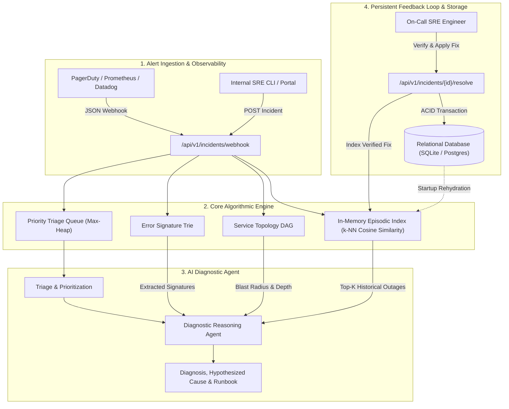

# RecallOps-AI: System Design & Architecture Specification

## 1. Executive Summary

**RecallOps-AI** is an AI-powered incident response and production intelligence platform engineered for Site Reliability Engineering (SRE) and DevOps teams.

The system addresses the fundamental flaw of modern incident management: **stateless triage**. Traditional incident workflows treat every recurring outage, connection storm, or cascading failure as a novel event. RecallOps-AI provides AI agents with **persistent episodic memory**, enabling them to instantly recall historical root causes, verify blast radiuses via dependency graph traversal, prioritize incoming alerts dynamically, and enforce verified operational fixes.

---

## 2. Architectural Overview



---

## 3. Persistent Memory Architecture: Database vs. In-Memory Search Index

A core architectural principle of RecallOps-AI is the clear separation between **Durable Persistence** and **Fast Algorithmic Search**:

```
+--------------------------------------------------------------------------+
|                        DURABLE PERSISTENCE LAYER                         |
|                    (SQLAlchemy ORM + SQLite/PostgreSQL)                  |
|                                                                          |
|  - Table: `incidents` (title, description, service_name, raw_logs)       |
|  - Table: `incident_resolutions` (root_cause, action_taken, verified_by) |
|  - Table: `webhook_events` (provider, event_id, deduplication, audit)    |
|  - ACID Guarantees: Transactional rollbacks on failure                   |
|  - Source of Truth: Survives process restarts, crashes, deployments      |
+--------------------------------------------------------------------------+
                                     |
               Startup Rehydration   |   Verified Resolution
             (rehydrate_from_db)     |   (record_resolution)
                                     v
+--------------------------------------------------------------------------+
|                       EPISODIC IN-MEMORY SEARCH INDEX                    |
|                        (EpisodicMemoryIndex in RAM)                      |
|                                                                          |
|  - Structure: Sparse TF-IDF token dictionary + precomputed vector norms  |
|  - Retrieval: Cosine Similarity k-NN ranking via min-heap               |
|  - Synchronization: Thread-safe via threading.RLock                     |
+--------------------------------------------------------------------------+
```

---

## 3.1 Webhook Adapter & Ingestion Pipeline

To interface reliably with third-party observability platforms, RecallOps-AI incorporates a modular webhook ingestion pipeline:

1. **Adapter Registry (`backend/app/integrations/`):**
   - Implements a uniform `BaseWebhookAdapter` interface for PagerDuty (v3/v2), Datadog, and Prometheus Alertmanager.
   - Encapsulates provider authentication (HMAC-SHA256 signatures, Bearer tokens, custom headers), schema parsing, and normalization.

2. **Database-Backed Deduplication:**
   - Provider delivery retries are checked against `webhook_events` table using an atomic `(provider, provider_event_id)` unique constraint.
   - Retries return HTTP `200 OK` with `status: DUPLICATE` to signal successful receipt to the provider without duplicating internal state.

3. **Lifecycle Synchronization:**
   - Correlates incoming alerts by `incident_key` (PagerDuty incident ID, Datadog alert ID, or Alertmanager fingerprint).
   - Dynamically updates incident status across `triggered` (OPEN), `acknowledged` (INVESTIGATING), and `resolved` (RESOLVED).

---

## 3.2 Real LLM-Powered Investigation Engine

RecallOps-AI Phase 3 replaces static template diagnosis with a provider-independent AI investigation architecture (`backend/app/ai/`):

1. **Multi-Modal Evidence Collection (`EvidenceService`):**
   - Synthesizes incident core metadata, trie-scanned error signatures, raw log extracts, topology DAG blast-radius calculations, and verified historical resolutions into a unified `EvidenceCollection`.
   - Explicitly models uninstrumented telemetry (`EVID-TELEM-*`), ensuring honest acknowledgment of missing data.

2. **Prompt Injection Defense & Neutralization (`PromptService`):**
   - Strips and neutralizes closing/opening XML tags within raw telemetry.
   - Constrains untrusted log strings inside strictly delimited `<untrusted_*>` blocks, commanding the model to treat content as passive data to analyze.

3. **Grounding & Anti-Hallucination Gatekeeper (`InvestigationService`):**
   - Cross-checks all `supporting_evidence_ids` against actual collected evidence IDs.
   - Automatically quarantines hallucinated citations into `hallucinated_evidence_ids` and flags `requires_human_review = True`.

4. **Human-in-the-Loop Feedback & Memory Gating:**
   - SREs review and approve/reject AI findings via `POST /api/v1/investigations/{id}/feedback`.
   - **Strict Memory Invariant:** Unverified AI hypotheses NEVER enter persistent episodic memory. Only human-approved resolutions are indexed into `EpisodicMemoryService`.
|  - Lifecycle: Ephemeral; rebuilt from verified database records on start |
+--------------------------------------------------------------------------+
```

### Key Properties:
1. **Source of Truth:** The database is the authoritative storage layer. Unverified diagnoses are never saved to the database as resolutions.
2. **Rehydration at Startup:** During FastAPI `lifespan` initialization, `EpisodicMemoryService.rehydrate_from_db()` queries `IncidentRepository.get_all_resolved()` to rebuild the TF-IDF vectors in RAM. If the database is empty, it initializes an empty index without hardcoded memory dependencies.
3. **Verified Ingestion Gate:** `record_resolution()` rejects any resolution where `verified_by` is absent or empty, guaranteeing that speculative or unverified triage notes never contaminate episodic memory.
4. **Duplicate Immunity:** Re-resolving an incident updates the existing database record in place and updates the memory index cleanly without inflating document counts or inverse document frequencies.

---

## 4. The 5 Core Engineering Pillars

RecallOps-AI is designed strictly around the **5 Core Concepts**:

### Pillar 1: Data Structures and Algorithms (DSA)

#### A. Vector Space Model & Cosine Similarity ($k$-NN Retrieval)
To achieve content-based recall over past incident reports and logs:
* **Tokenization & Term Frequency ($TF$):**
  $$TF(t, d) = \frac{f_{t,d}}{\sum_{t' \in d} f_{t', d}}$$
* **Inverse Document Frequency ($IDF$):**
  $$IDF(t, D) = \ln\left(\frac{|D| + 1}{|\{d \in D : t \in d\}| + 1}\right) + 1$$
* **Cosine Similarity Metric:**
  $$S_C(\vec{u}, \vec{v}) = \frac{\vec{u} \cdot \vec{v}}{\|\vec{u}\|_2 \|\vec{v}\|_2} = \frac{\sum_{i=1}^n u_i v_i}{\sqrt{\sum_{i=1}^n u_i^2} \sqrt{\sum_{i=1}^n v_i^2}}$$
* **Complexity:**
  * Search scan across $N$ indexed incidents: $\mathcal{O}(N \times \min(|u|, |v|))$
  * Top-$K$ ranking using min-heap: $\mathcal{O}(N \log K)$

#### B. Priority Queue / Max-Heap for Dynamic Alert Triage
Alerts must not be processed purely First-In-First-Out (FIFO). A Sev-1 payment outage must preempt a Sev-3 UI alignment alert.
* **Multivariate Scoring Function:**
  $$\text{Score} = w_{\text{sev}} \cdot S + w_{\text{tier}} \cdot T + w_{\text{impact}} \cdot \min(100, 20 \log_{10}(U + 1))$$
  * $w_{\text{sev}} = 0.40$ (CRITICAL=100, HIGH=75, MEDIUM=50, LOW=20)
  * $w_{\text{tier}} = 0.30$ (TIER_0=100, TIER_1=70, TIER_2=40, TIER_3=10)
  * $w_{\text{impact}} = 0.20$ ($U = \text{impacted users}$)
* **Complexity:** Insertion $\mathcal{O}(\log M)$, Deletion $\mathcal{O}(\log M)$, Peek $\mathcal{O}(1)$ where $M$ is active queue size.
* **Concurrency:** Thread-safe using `threading.RLock`.

#### C. Directed Acyclic Graph (DAG) for Microservice Blast Radius
* **Adjacency Representation:** Downstream dependency mapping $G = (V, E)$.
* **Downstream Propagation (BFS):**
  Traverses all microservices dependent on the failing node. Each hop distance attenuates impact:
  $$\text{ImpactWeight}(d) = \frac{1.0}{d + 1}$$
* **Cycle Detection:** DFS using 3-color vertex marking (WHITE=0, GREY=1, BLACK=2) in $\mathcal{O}(V + E)$ time to identify recursive dependencies.

#### D. Trie (Prefix Tree) for Log Token & Signature Matching
* **Error Tokenization:** Matches tokens against critical signatures (e.g., `ERR_503`, `OOM_KILLED`, `DEADLOCK`, `DNS_TIMEOUT`).
* **Complexity:** Exact prefix lookup in $\mathcal{O}(L)$ where $L$ is token length, independent of dictionary size.

---

### Pillar 2: API Integration

* **RESTful Clean Architecture:**
  * Endpoints separated into clear functional domains under `/api/v1/`.
  * Dependency injection pattern via FastAPI's `Depends(get_db)`.
  * Separation of concerns: Routers $\rightarrow$ Services $\rightarrow$ Repositories $\rightarrow$ SQLAlchemy ORM Models.
* **Webhook Ingestion:**
  * Webhook listener mapped to structured Incident models.
* **Database & Persistence:**
  * Relational metadata persisted via SQLAlchemy with transactional isolation, rollback error handlers, and foreign key constraints between `incidents` and `incident_resolutions`.

---

### Pillar 3: Prototyping & MVP Execution

* **End-to-End Incident Lifecycle:**
  $$\text{OPEN} \xrightarrow{\text{Webhook / Ingest}} \text{INVESTIGATING} \xrightarrow{\text{AI Diagnosis}} \text{MITIGATED} \xrightarrow{\text{Verified Fix}} \text{RESOLVED}$$
* **Database-Driven Memory Seeding:**
  * Canonical production outages seeded directly into the relational database on first run, providing durable grounding for vector search rehydration.

---

### Pillar 4: Testing & Validation

* **Validation Strategy:**
  * 100% test pass rate across 28 automated unit and integration tests.
  * Dedicated persistence tests: Service recreation, full application restart on temporary databases, duplicate resolution handling, and database failure handling.
  * Algorithmic verification: Vector similarity ranking, heap priority monotonicity, BFS blast radius traversal, cycle detection.
  * Schema edge-case testing: Pydantic field constraint checks (negative user values, missing required fields).

---

### Pillar 5: Technical Documentation

* Complete OpenAPI 3.1 interactive documentation served at `/docs`.
* System design blueprints, algorithmic proofs, and endpoint curl examples in `/docs/`.
