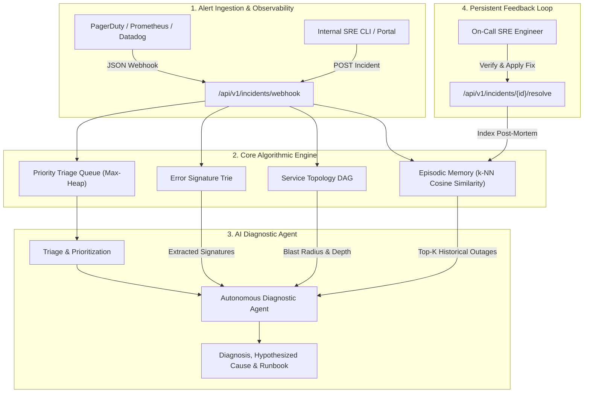

# RecallOps-AI: System Design & Architecture Specification

## 1. Executive Summary

**RecallOps-AI** is an AI-powered incident response and production intelligence platform engineered for Site Reliability Engineering (SRE) and DevOps teams.

The system addresses the fundamental flaw of modern incident management: **stateless triage**. Traditional incident workflows treat every recurring outage, connection storm, or cascading failure as a novel event. RecallOps-AI provides AI agents with **persistent episodic memory**, enabling them to instantly recall historical root causes, verify blast radiuses via dependency graph traversal, prioritize incoming alerts dynamically, and enforce verified operational fixes.

---

## 2. Architectural Overview

---

## 3. The 5 Core Engineering Pillars

RecallOps-AI is designed strictly around the **5 Core Concepts**:

### Pillar 1: Data Structures and Algorithms (DSA)

#### A. Vector Space Model & Cosine Similarity ($k$-NN Retrieval)
To achieve content-based recall over past incident reports and logs:
* **Tokenization & Term Frequency ($TF$):**
  $$TF(t, d) = \frac{f_{t,d}}{\sum_{t' \in d} f_{t', d}}$$
* **Inverse Document Frequency ($IDF$):**
  $$IDF(t, D) = \ln\left(\frac{|D| + 1}{|\{d \in D : t \in d\}| + 1}\right) + 1$$
* **Cosine Similarity Metric:**
  $$S_C(\vec{u}, \vec{v}) = \frac{\vec{u} \cdot \vec{v}}{\|\vec{u}\|_2 \|\vec{v}\|_2} = \frac{\sum_{i=1}^n u_i v_i}{\sqrt{\sum_{i=1}^n u_i^2} \sqrt{\sum_{i=1}^n v_i^2}}$$
* **Complexity:**
  * Vector generation: $\mathcal{O}(|tokens|)$
  * Comparison against $N$ indexed incidents: $\mathcal{O}(N \times \min(|u|, |v|))$
  * Top-$K$ ranking using min-heap: $\mathcal{O}(N \log K)$

#### B. Priority Queue / Max-Heap for Dynamic Alert Triage
Alerts must not be processed purely First-In-First-Out (FIFO). A Sev-1 payment outage must preempt a Sev-3 UI alignment alert.
* **Multivariate Scoring Function:**
  $$\text{Score} = w_{\text{sev}} \cdot S + w_{\text{tier}} \cdot T + w_{\text{impact}} \cdot \min(100, 20 \log_{10}(U + 1))$$
  * $w_{\text{sev}} = 0.40$ (CRITICAL=100, HIGH=75, MEDIUM=50, LOW=20)
  * $w_{\text{tier}} = 0.30$ (TIER_0=100, TIER_1=70, TIER_2=40, TIER_3=10)
  * $w_{\text{impact}} = 0.20$ ($U = \text{impacted users}$)
* **Complexity:** Insertion $\mathcal{O}(\log M)$, Deletion $\mathcal{O}(\log M)$, Peek $\mathcal{O}(1)$ where $M$ is active queue size.

#### C. Directed Acyclic Graph (DAG) for Microservice Blast Radius
* **Adjacency Representation:** Downstream dependency mapping $G = (V, E)$.
* **Downstream Propagation (BFS):**
  Traverses all microservices dependent on the failing node. Each hop distance attenuates impact:
  $$\text{ImpactWeight}(d) = \frac{1.0}{d + 1}$$
* **Cycle Detection:** DFS using 3-color vertex marking (WHITE=0, GREY=1, BLACK=2) in $\mathcal{O}(V + E)$ time to identify recursive dependencies.

#### D. Trie (Prefix Tree) for Log Token & Signature Matching
* **Error Tokenization:** Matches tokens against critical signatures (e.g., `ERR_503`, `OOM_KILLED`, `DEADLOCK`, `DNS_TIMEOUT`).
* **Complexity:** Exact prefix lookup in $\mathcal{O}(L)$ where $L$ is token length, independent of dictionary size.

---

### Pillar 2: API Integration

* **RESTful Clean Architecture:**
  * Endpoints separated into clear functional domains under `/api/v1/`.
  * Dependency injection pattern via FastAPI's `Depends(get_db)`.
  * Separation of concerns: Routers $\rightarrow$ Services $\rightarrow$ Repositories $\rightarrow$ SQLAlchemy ORM Models.
* **Webhook Ingestion:**
  * Normalized schema supporting incoming JSON payloads from PagerDuty, Prometheus Alertmanager, Datadog, and Grafana.
* **Database & Persistence:**
  * Relational metadata persisted via SQLAlchemy with transactional isolation and foreign key constraints between `incidents` and `incident_resolutions`.

---

### Pillar 3: Prototyping & MVP Execution

* **End-to-End Incident Lifecycle:**
  $$\text{OPEN} \xrightarrow{\text{Webhook / Ingest}} \text{INVESTIGATING} \xrightarrow{\text{AI Diagnosis}} \text{MITIGATED} \xrightarrow{\text{Verified Fix}} \text{RESOLVED}$$
* **Zero-Cold-Start Memory Seeding:**
  * Pre-loaded with canonical production outages (PgBouncer connection pool saturation, Redis OOM LRU eviction storm, Kubernetes CoreDNS ndots:5 timeout, Third-party rate limiting, Kafka consumer partition rebalancing).

---

### Pillar 4: Testing & Validation

* **Validation Strategy:**
  * 100% test pass rate across 20 automated unit and integration tests.
  * Algorithmic verification: Vector similarity ranking, heap priority monotonicity, BFS blast radius traversal, cycle detection.
  * API integration tests: Alert ingestion, automated triage, AI diagnosis, and resolution feedback.
  * Schema edge-case testing: Pydantic field constraint checks (negative user values, missing required fields).

---

### Pillar 5: Technical Documentation

* Complete OpenAPI 3.1 interactive documentation served at `/docs`.
* System design blueprints, algorithmic proofs, and endpoint curl examples in `/docs/`.
